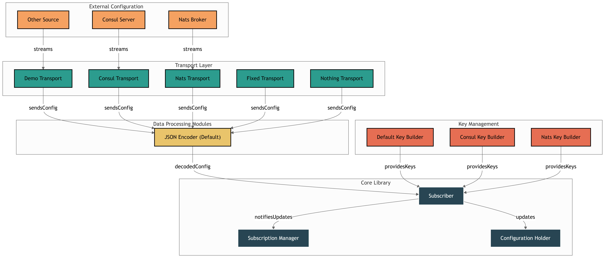

# Streaming-Based Config

Streaming-Based Config is a helper library for accessing structured configurations based on event streaming/subscription.

## Installation

To install the Streaming-Based-Config library, you can use `go get`:

```bash
go get github.com/Autodoc-Technology/streaming-based-config
```

## Usage

Here's a basic example of how to use the Streaming-Based-Config library:

```go
sub := sbc.NewSubscriber[SimpleConfig](
    sbctransport.NewDemoTransport([]byte(`{"value": 1, "value2": "hello"}`), 3*time.Second),
    sbc.DefaultKeyBuilder[SimpleConfig](),
)
confSubs, err := sub.Subscribe(ctx)
if err != nil {
    log.Fatalf("Failed to subscribe: %v", err)
}
defer confSubs.Unsubscribe()

// get the current value
config := confSubs.Get()
log.Printf("Get Config: %+v", config)

// subscribe to the values stream
for val := range confSubs.GetUpdates() {
    log.Printf("Config: %+v", val)
}

```

### Transports

The library supports various transports for fetching configuration:

- **ConsulTransport**: Fetches configuration from HashiCorp Consul KV.
- **NatsTransport**: Fetches configuration via NATS JetStream.
- **KafkaTransport**: Fetches configuration from a Kafka topic using `github.com/IBM/sarama`. [See Example](example/kafka/main.go)
- **FixedTransport**: Returns a static configuration (useful for testing or defaults).
- **ChainTransport**: Merges configuration from multiple transports, allowing for layered configuration (e.g., defaults + overrides). [See Example](example/chain/main.go)

For more detailed examples, please refer to the `example` directory.

## Development plan
- [x] Basic code structure
- [x] Unit tests for most of the code
- [x] Nats transport implementation
- [x] Consul transport implementation
- [x] Unit tests for Subscriber/Subscriptions (with mocks)
- [x] Kafka transport implementation

## Contributing

We welcome contributions from the community. If you wish to contribute, please follow these steps:

1. Fork the repository
2. Create your feature branch (`git checkout -b feature/AmazingFeature`)
3. Commit your changes (`git commit -m 'Add some AmazingFeature'`)
4. Push to the branch (`git push origin feature/AmazingFeature`)
5. Open a pull request

## Project Diagram



## License

This project is MIT licensed. For more information, please refer to the `LICENSE` file.

## Contact

http://autodoc.eu/

Project
Link: [https://github.com/Autodoc-Technology/streaming-based-config](https://github.com/Autodoc-Technology/streaming-based-config)
